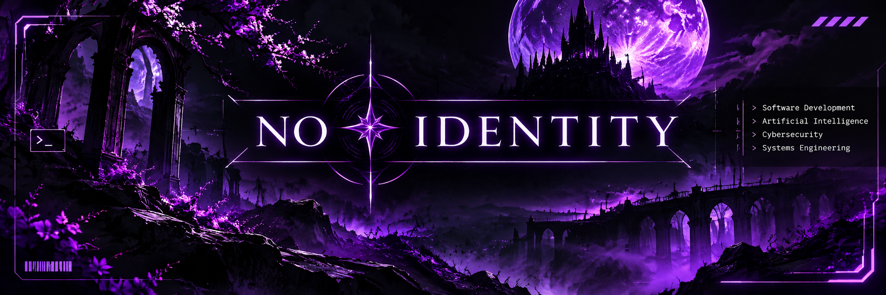

# Hi, I'm X.

### Computer Systems Engineering Student

Focused on software development, technology, and continuous learning.

---

### About Me

- Computer Systems Engineering student based in Mexico.
- Interested in software engineering, artificial intelligence, and cybersecurity.
- Currently strengthening my programming and problem-solving skills.
- Exploring new technologies and building practical projects.

### Technologies & Tools

<h3 align="center">GitHub Activity</h3>

  

---

### Areas of Interest

`Software Development` · `Artificial Intelligence` · `Cybersecurity`

---

*Learning. Building. Improving.*

  
